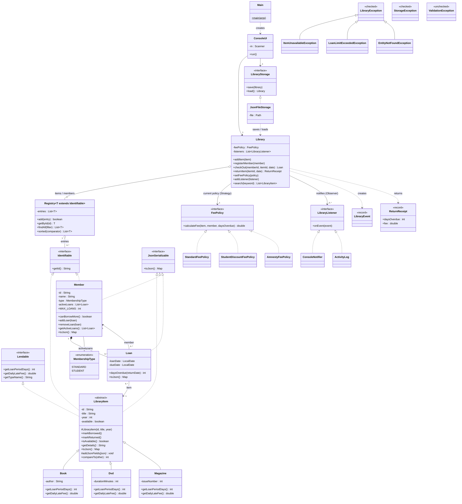

# UML Class Diagram

Written in [Mermaid](https://mermaid.js.org/) – GitHub and GitLab render it automatically
when you open this file. `+` = public, `-` = private, `#` = protected.

## Multiplicities in words

| Relationship | Meaning |
|---|---|
| Library ◇— Registry | The library **aggregates** one item registry and one member registry. |
| Member ◆— Loan (1 to 0..*) | **Composition**: a member owns their active loans; a loan never outlives its member. |
| Loan —> LibraryItem (many to 1) | An item can appear in at most one *active* loan, but many loans over time. |
| Library —> FeePolicy (1) | Exactly one fee policy is active; it can be swapped at runtime. |
| Library —> LibraryListener (0..*) | Any number of observers. |
